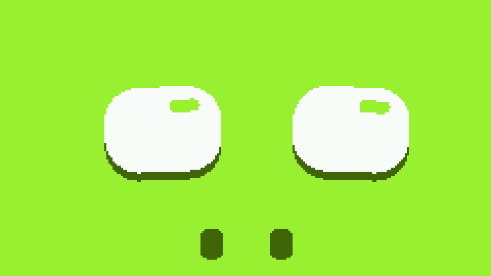
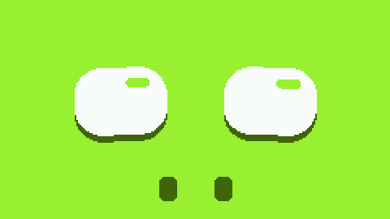
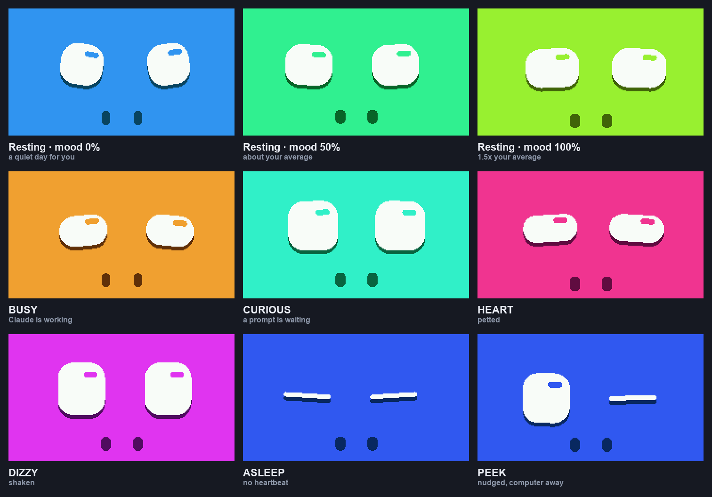
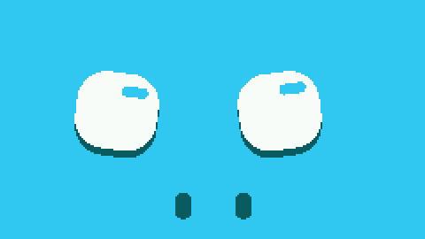
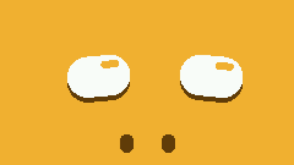
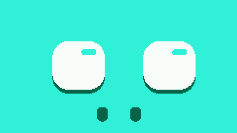

# NessoHippo

A desk companion for the [Arduino Nesso N1](https://www.arduino.cc/) that pairs
over Bluetooth LE with the Claude desktop app — and whose mood tracks how many
tokens you have used today, measured against **your own** recent daily average.

<p align="center">
  
</p>

It is a fork of [NessoBuddy](https://github.com/lukdog/NessoBuddy), which ports
[anthropics/claude-desktop-buddy](https://github.com/anthropics/claude-desktop-buddy)
to the Nesso N1. NessoBuddy's ASCII cat is still in here and still works —
NessoHippo adds a second persona, **NessoFace**, and makes it the default.

> Every image below is rendered by the real `face.cpp` drawing code compiled on
> the host against a stub sprite, at the panel's own 240×135 and quantised to
> RGB565. They are what the screen draws, pixel for pixel — not mockups.

## NessoFace

Two large white squircle eyes and two nostrils, filling the whole 240×135
landscape screen. No mouth, no ears, no head outline: the hippo is implied by
the wide-set eyes and the low nostrils, and never drawn. The restraint is the
design.

Everything on screen comes from seven numbers, redrawn every frame:

| Parameter | Range | Meaning |
|---|---|---|
| `eyeOpen` | 0–1 | vertical scale of the eye |
| `lidTilt` | −1…1 | −1 angry (inner corners down), +1 sad (up) |
| `pupilX` / `pupilY` | −1…1 | gaze; moves the whole eye |
| `joy` | −1…1 | eye squash and nostril flare |
| `bgHue` | 0–360 | background hue |
| `bounce` | 0–4 | breathing amplitude, px |

There is no mouth parameter. With nothing to bend, happiness reads through the
eye proportions — wide and squat is happy, tall and narrow is sad — and through
the nostrils.

Three flat colours, all derived from one hue: `bg = HSV(h, .78, .95)`,
`dark = HSV(h−8, .88, .40)`, and white. No gradients, no blur, no antialiasing
anywhere. The drop shadow is a hard copy of the eye offset four pixels straight
down, and the highlight is a streak of the *background* cut into the eye — not
light added, white removed.

## Mood from tokens

```
mood = clamp(tokens_today / baseline, 0, 1.5) / 1.5
```

<p align="center">
  
</p>

The interesting part is the denominator. `baseline` is an exponential moving
average of your own previous daily totals — at your local midnight,
`baseline = 0.8 × baseline + 0.2 × yesterday` — seeded to 50 000 on first run
and persisted in NVS. Full green means **1.5× your own average**, not a number
somebody picked.

That makes it self-calibrating, and a little merciless. Seven identical 90k-token
days:

| Day | Baseline | Mood at 90k |
|---|---|---|
| 1 | 50 000 | 100% |
| 3 | 64 400 | 93% |
| 5 | 73 616 | 82% |
| 7 | 79 514 | 75% |

Same day's work, falling mood — because 90k has stopped being a big day *for
you*. A fixed threshold would show green every day and you would stop looking at
it.

Local midnight needs `{"time":[unix, tzOffsetSec]}` from the desktop, which
NessoBuddy acknowledged and ignored; here both values are kept and a change in
`(unix + tzOffset) / 86400` triggers the rollover.

## States

<p align="center">
  
</p>

Priority order, highest first:

| State | When |
|---|---|
| `ASLEEP` | no heartbeat for 30 s, face-down, or backlight off |
| `DIZZY` | shake, ~2 s |
| `HEART` | screen petted, or `{"cmd":"owner"}`, ~2 s |
| `CURIOUS` | a prompt is pending, or a heartbeat just resumed after a nap |
| `BUSY` | `running > 0` |
| resting | the mood-driven default |

NessoFace draws no approval overlay: a pending prompt just makes it curious, the
chirp still plays, and KEY1/KEY2 approve and deny exactly as before.

Note how close the blue of `ASLEEP` (hue 228) is to the sad end of the resting
blend (hue 210). What tells them apart is the **eyes**, not the colour: asleep is
two flat slits, a bad day is big and oval.

## Idle life

Without these the face looks dead even when it is happy. A blink every 2.6–6 s
(12% of them doubles) that also widens the eye by 12%, a 3 s breathing bob, and a
gaze that retargets every 1.9–4.3 s and gets there with a deliberately snappy
lerp — a fast saccade reads as alive, a slow glide reads as sleepy.

Two states get their own behaviour, because a face that only changes shape and
then freezes is not much better than a static one:

| While Claude works | While something is pending |
|---|---|
|  |  |
| The gaze steps along fixed stops and flicks back to the start, like reading a line. It is the one thing that reads as an *activity* rather than a mood. The nostrils quiver on a 300 ms cycle. | The lids rock on a 2.6 s cycle, so it does not freeze in a wide-eyed pose. Kept out of the parameter vector, like blink and breathing, because it must never be interpolated. |

## Sleeping and waking

<p align="center">
  
</p>

The backlight goes dark after 30 s of idling on battery, but it is no longer a
one-way trip — NessoBuddy could only switch it back on for a pending prompt or
for USB power, and with the desk computer asleep neither can happen, so the
device simply looked dead until a button was pressed. Now a resumed heartbeat
wakes it, and so does a touch or a nudge.

If the computer is *away*, that wake is deliberately half-hearted: the face
cracks **one eye** open, picked at random, looks around for a couple of seconds,
then shuts it and goes back to sleep. Someone knocked the desk; that does not
deserve 30 s of backlight.

A sleeping face is worth leaving lit, though — it reads as a creature napping
where a black screen reads as a dead gadget — so when the only reason it is
asleep is that the computer is away, the backlight gets **two hours** instead of
thirty seconds, at 5 fps since all it does is breathe by one pixel.

## Keeping the link honest

The transport needed two fixes that NessoBuddy never had, both found by
measuring on the device rather than reasoning about it:

- **An advertising watchdog.** `onDisconnect` is a callback, and a peer whose
  radio simply goes away — a laptop suspending — can leave it undelivered. The
  device would then sit there invisible, convinced it was still paired. `bleTick()`
  trusts the stack's own connection count over our flag and re-asserts advertising
  while nothing is connected.
- **Hanging up on a silent link.** The Mac can suspend and resume while holding
  the link open the whole time, with the desktop never resuming its heartbeats.
  The device was connected to a peer that had stopped talking, and only a manual
  Reconnect revived it — because nothing had ever disconnected, so the desktop had
  no event to react to. After two minutes of silence the device hangs up; the
  desktop then reconnects by itself in about three seconds.

The stats panel (KEY2 long-press) reports `Gap`, `Mood`, `Today` and `Dis/Adv`,
so the next time something looks wrong you can read the device instead of
guessing at the host.

## Controls

As NessoBuddy, with one addition:

| Gesture | Effect |
|---|---|
| KEY1 short | Approve a pending prompt / wake the screen |
| KEY1 long | Toggle mute |
| KEY2 short | Deny a prompt, or cycle persona (cat ↔ face) when nothing is pending |
| KEY2 long | Stats panel |
| Touch | Pet → HEART, and wakes the screen |
| Shake | DIZZY |
| Nudge | Wakes the screen; one-eyed peek if the computer is away |
| Face-down | Sleep |

The persona is persisted (`persona`, default 1 = face). The stats panel is
portrait-only and borrows the rotation while it is up.

## Build & flash

```sh
arduino-cli compile -b esp32:esp32:arduino_nesso_n1 NessoHippo
arduino-cli upload  -b esp32:esp32:arduino_nesso_n1 -p /dev/cu.usbmodem1101 NessoHippo
```

Dependencies, installed once:

```sh
arduino-cli core install esp32:esp32
arduino-cli lib  install ArduinoJson        # 7.x
arduino-cli lib  install Arduino_Nesso_N1
```

Footprint: **28% flash, 7% static RAM**, plus a 63 KB sprite on the heap —
allocated on first activation of a persona and then kept, because freeing and
reclaiming it on every switch would fragment a heap shared with NimBLE.

## Tuning knobs

Constants live at the top of their own file, per the repo's convention.

- `face.cpp` — `LERP_RATE`, `GAZE_LERP`, `BLINK_*`, `BREATH_MS`, `GAZE_*`,
  `READ_*`, `TILT_ROCK_*`, `NOSE_QUIVER_*`, the state table, and the geometry.
- `mood.cpp` — `BASELINE_ALPHA`, `BASELINE_SEED`, `MOOD_CAP`.
- `NessoHippo.ino` — `FACE_FRAME_MS`, `HEARTBEAT_STALE_MS`, `LINK_STALE_MS`,
  `ASLEEP_OFF_MS`, `PEEK_*`, plus everything NessoBuddy already had.
- `motion.cpp` — `NUDGE_THRESHOLD_G` alongside the existing shake thresholds.

## Implementation notes

- **Rotation and touch.** The face runs `setRotation(1)` for 240×135; the cat
  stays portrait. `ui.cpp` owns the rotation and both sprites, so nothing else
  may assume either. `NessoTouch` reports raw portrait panel coordinates and
  knows nothing about rotation, so every tap goes through `uiMapTouch()`.
- **No antialiasing.** `fillSmoothRoundRect()` blends its edges, which would
  break the no-blur rule, so the eyes use a small rotated-rounded-rect
  rasterizer instead: integer Q16 with incremental per-column stepping, because
  the ESP32-C6 has no FPU, filling one span per row since the shape is convex.
- **Frame-rate independence.** The 64 KB sprite push is polled SPI, not DMA, and
  blocks for ~26 ms on its own, so the panel manages about 27 fps rather than 30.
  The interpolation is scaled by measured frame time instead of assuming a rate,
  which is also what lets the sleeping face drop to 5 fps for free.

The original brief for the persona is kept in
[`NESSOFACE_SPEC.md`](NESSOFACE_SPEC.md). Where the implementation departs from
it — the drop shadow, the welcome-back timing, a couple of acceptance-test
details — the commit messages say why.

## Credits

- Upstream design and BLE protocol: [anthropics/claude-desktop-buddy](https://github.com/anthropics/claude-desktop-buddy)
- The port this one forks: [lukdog/NessoBuddy](https://github.com/lukdog/NessoBuddy)
- Hardware library: [arduino-libraries/Arduino_Nesso_N1](https://github.com/arduino-libraries/Arduino_Nesso_N1)
- Built with the Arduino ESP32 core, [LovyanGFX](https://github.com/lovyan03/LovyanGFX) (via M5GFX), and [ArduinoJson](https://arduinojson.org/)
